<a href="#gh-dark-mode-only">
<picture>
  <source media="(max-width: 768px)" srcset="https://raw.githubusercontent.com/amansanoj/.github/main/assets/hero-dark-mobile.svg">
  
</picture>
</a>
<a href="#gh-light-mode-only">
<picture>
  <source media="(max-width: 768px)" srcset="https://raw.githubusercontent.com/amansanoj/.github/main/assets/hero-light-mobile.svg">
  
</picture>
</a>

<a href="https://amansanoj.is-a.dev">Website ↗</a> &nbsp; / &nbsp; <a href="https://github.com/amansanoj?tab=repositories">All repositories ↗</a>

I build ESP32 firmware, native macOS utilities, and web applications. My projects include BLE device integrations, firmware update systems, and synchronized media playback.

### Selected Projects

| Project | Implementation | Stack |
| :--- | :--- | :--- |
| **[NeonOS ↗](https://github.com/amansanoj/neon-os)** | BLE-to-HomeKit bridge with OLED controls, signed HTTPS firmware updates, and boot-health rollback. Includes native regression and fault tests; OTA hardware acceptance is still pending. | C++ · ESP32 · HomeSpan |
| **[Macro Pad ↗](https://github.com/amansanoj/macro-pad)** | Four-key BLE controller with a native macOS companion. Versioned input packets, duplicate-event suppression, automatic reconnection, and per-application assignments. | C++ · SwiftUI · CoreBluetooth |
| **[Tether ↗](https://github.com/amansanoj/tether)** | Watch-party server with an authoritative playback clock, drift correction, linked rooms, reconnect recovery, and host controls. | TypeScript · Bun · WebSockets |
| **[Cardputer Now Playing ↗](https://github.com/amansanoj/cardputer-nowplaying)** | Apple Music display and controller with a macOS bridge, BLE artwork transfer, on-device caching, and physical playback controls. | C++ · Python · ESP32-S3 |

Other Projects

 

- **[Terminal Portfolio](https://github.com/amansanoj/tui-portfolio)**: SSH interface built with Go, Bubble Tea, and Wish; project content refreshes from Notion.
- **[NanoLink](https://github.com/amansanoj/nanolink-api)**: Bun and Hono URL shortener with expiring links, click limits, analytics, and QR codes.
- **[UI Components](https://github.com/amansanoj/ui)**: React component workspace with shared design tokens, ESM/CJS builds, and Changesets releases.
- **[4-Bit Pincode](https://github.com/amansanoj/hackclub-embassy-4-bit-pincode)**: Sequential passcode circuit using a shift register and discrete components, without a microcontroller.

 

<a href="#gh-dark-mode-only">
<picture>
  <source media="(max-width: 768px)" srcset="https://raw.githubusercontent.com/amansanoj/.github/main/assets/activity-dark-mobile.svg">
  
</picture>
</a>
<a href="#gh-light-mode-only">
<picture>
  <source media="(max-width: 768px)" srcset="https://raw.githubusercontent.com/amansanoj/.github/main/assets/activity-light-mobile.svg">
  
</picture>
</a>

Built from my public GitHub activity. Refreshed daily. <a href="https://github.com/amansanoj/.github/blob/main/scripts/build_profile.py">How it's made ↗</a>
